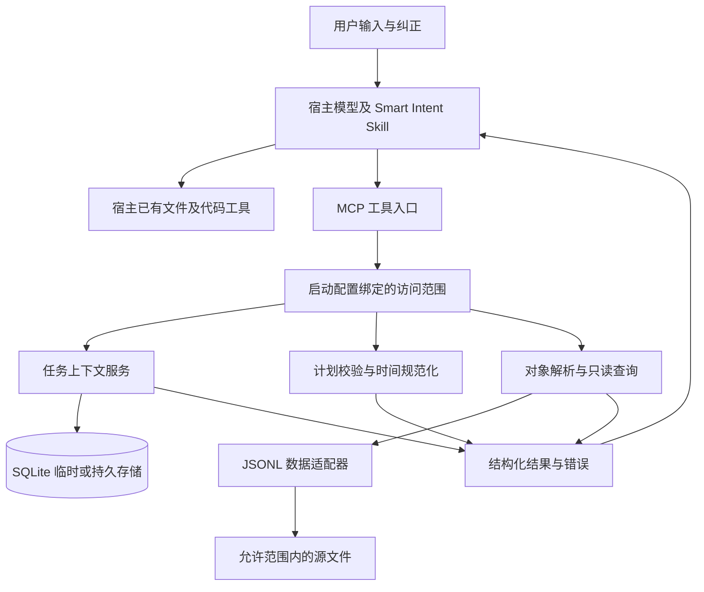

# Smart Intent 智能体协作插件实现方案

版本：0.1　日期：2026年11月4日　状态：技术评审

依据：[Smart Intent 产品需求文档 0.1](./SmartIntent_产品需求文档.md)。

本文给出首版的建议技术决策、模块职责、存储模型、工具契约、执行流程、测试与交付步骤。接口、配置和示例均为拟实现设计，不表示服务已经开发或数据源已经接通。首版先完成一个本地宿主与一个真实只读数据源的闭环，再扩展平台和业务操作。

## 1 实现范围与技术决策

### 1.1 首版范围

实现任务上下文、对象消歧、参数校验、时间规范化、只读记录查询及结果来源追踪。保留现有 Skill，由宿主模型完成语义理解及回复；服务不再用姓名名单、空格分词或固定置信度判断用户意图。

首版不提供补发、发送、配置修改或其他业务写接口。用户要求这些动作时，保留动作及范围，返回不支持执行的明确状态，必要时允许先查询候选记录。

文件评估和代码修改仍由宿主已有能力承担。插件不为这些原生能力再建一套执行器，不强制每次对话都调用插件。

### 1.2 技术栈

| 项目 | 建议选择 | 选择原因及边界 |
|---|---|---|
| 运行时 | Python 3.11 及以上，开发时固定一个小版本 | 标准库可覆盖时间、文件、SQLite 与摘要计算 |
| MCP | 官方 Python SDK 2.x，stdio 传输 | 本地部署简单；连接兼容性须在试点宿主验证 |
| 模型定义 | Pydantic 类型模型，禁止未声明字段 | 统一工具参数、领域对象与结果校验 |
| 配置 | TOML，由启动参数指定绝对路径 | 配置访问范围，不从业务文件中读取权限 |
| 上下文存储 | 标准库 sqlite3；临时模式使用内存数据库 | 默认不落盘；持久模式单独启用 |
| 首个适配器 | 明确字段映射的 UTF-8 JSONL 文件 | 能以少量代码验证筛选、时间、来源及分页 |
| 时间处理 | datetime 与 zoneinfo，Windows 部署包含 tzdata | 含时区时间参与计算，UTC 作为存储基准 |
| 测试 | pytest，必要时 pytest-asyncio | 覆盖领域逻辑、stdio 契约及宿主行为 |
| 构建 | pyproject.toml、虚拟环境、依赖锁文件 | 安装后使用确定的解释器及依赖版本 |

官方 SDK 当前文档将 2.x 列为稳定线，要求 Python 3.11+，并提供 stdio 服务能力。首个开发里程碑必须验证 SDK 与宿主的实际连接和结构化结果兼容性，再锁定精确版本。不能混用旧版 FastMCP 导入方式和新版接口。[官方 SDK 文档](https://py.sdk.modelcontextprotocol.io/v2/)、[版本变更说明](https://py.sdk.modelcontextprotocol.io/whats-new/)。

不为本文编造精确补丁版本。开发时锁定实际验证版本，并在发布清单记录宿主版本、SDK 版本、协议兼容模式及工具 schema 版本。

## 2 总体架构与信任边界



### 2.1 职责划分

- **宿主模型与 Skill**：识别目标、继承清晰上下文、处理语义歧义、选择专业工具、解释结果；不输出内部推理过程。
- **MCP 入口**：参数及输出 schema 校验、request_id、错误映射和执行时限。
- **领域服务**：任务版本、有效期、对象候选、时间边界、动作与数据能力校验。
- **数据适配器**：真正应用全部条件，生成来源定位，报告完整性。
- **启动配置**：绑定主体、项目、允许数据源和持久化策略；工具参数不能修改这些权限。

MCP 仅提供调用接口，不自动获得完整聊天历史，也不保证模型调用工具。安装 Skill 与验证宿主路由属于交付的一部分。宿主本身的权限控制继续生效，服务端仍独立检查访问范围。

### 2.2 首版部署边界

采用单用户、本地进程、单项目实例。主体标识和项目标识来自经用户配置的启动文件，不接受模型传入任意主体。一个安装可创建多个项目配置，但每个服务实例只能访问其绑定项目。

MCP 连接、进程生命周期和聊天会话不是同一概念。宿主若无法提供可信会话标识，使用显式任务句柄衔接；不自动列出或恢复其他聊天的任务，也不承诺聊天之间具备独立身份认证。需要严格聊天隔离时，必须增加可信会话适配，或为每个会话启动独立实例。

相同操作系统账号下能修改配置或读取服务文件的其他程序，不在本地插件可独立防御的边界内。多用户远程服务不进入首版，后续需增加认证及服务端授权。

## 3 仓库结构与模块依赖

建议在现有目录中新增实现代码，保持现有需求与 Skill 文件可追踪：

```text
smart-intent/
  SKILL.md
  pyproject.toml
  uv.lock
  src/smart_intent/
    __main__.py                 启动及命令行参数
    server.py                   SDK 注册与结果序列化
    config.py                   配置解析及启动范围
    models/                     工具参数 领域对象 结果 envelope
    services/
      contexts.py               创建读取更新清除与版本控制
      targets.py                目标查找与候选生成
      plans.py                  动作范围及数据能力校验
      time_ranges.py            时间表达规范化
      queries.py                查询编排与完整性
    storage/
      contexts.py               SQLite repository
      migrations/               持久数据库版本迁移
    adapters/
      base.py                   适配器协议
      jsonl.py                  首个只读适配器
    security/
      scope.py                  项目主体与数据源检查
      paths.py                  文件范围检查
      cursors.py                分页游标签名与绑定
    observability.py            stderr 事件日志与耗时
  config/smart-intent.example.toml
  integrations/qoder/            接入配置及验证记录
  tests/unit/
  tests/integration/
  tests/fixtures/                标注为测试数据的 JSONL
  evals/                        固定任务集 人工评分及结果
  docs/
```

上层服务依赖适配器协议及 repository，不依赖具体宿主。MCP 层不包含 SQL 或路径拼接。旧脚本不导入新服务，也不作为结果回退路径。目录中的 docs 构建脚本与 QA 预览不参与插件运行。

## 4 配置与启动流程

### 4.1 配置示例

以下为开发配置示例，路径及字段需按真实数据源替换；加载配置本身不代表已获业务访问授权。

```toml
schema_version = 1
principal_id = "local-user"
project_id = "xqd"
project_root = "D:/xqd"
timezone = "Asia/Shanghai"

[context]
mode = "ephemeral"
ttl_seconds = 86400
# persistent 模式必须显式启用，并指定项目外或受控目录下的绝对路径。
# database_path = "D:/smart-intent-data/xqd/contexts.sqlite3"
# 持久化建议有效期 604800 秒，最终按产品评审确定。

[limits]
page_size_default = 50
page_size_max = 200
candidate_limit = 5
source_bytes_max = 20971520
source_records_max = 100000
snapshot_cache_bytes_max = 52428800
snapshot_ttl_seconds = 300
query_timeout_seconds = 10
result_bytes_max = 262144

[[sources]]
id = "project-events"
path = "D:/xqd/data/events.jsonl"
allowed_root = "D:/xqd/data"
classification = "real"

[sources.fields]
record_id = "id"
target_id = "target_id"
target_name = "target_name"
timestamp = "occurred_at"
status = "status"
category = "category"
summary = "summary"
```

以上限额是首版建议值，应通过试点负载验证。candidate_limit 达到上限且仍有更多候选时必须返回 truncated=true，不得选择其中一个作为唯一对象。数据源大小、记录数或结果大小超限需明确失败或合法分页，不静默截断。

### 4.2 启动顺序

1. 解析启动参数并校验配置版本、绝对路径及唯一数据源 ID。
2. 建立只读业务数据范围，拒绝配置路径中的不支持链接类型。
3. 创建服务作用域及独立实例标识；临时模式创建内存 SQLite。
4. 持久模式核验存储目录权限并执行迁移；迁移失败停止启动，不清空旧数据。
5. 注册工具及 schema，启动 stdio 服务。

stdout 仅用于 MCP 协议流；调试、健康及异常信息写入 stderr。服务不在启动时自动扫描整个项目，也不自动写入宿主设置或启用绕过权限模式。

## 5 领域数据结构

### 5.1 任务上下文

```json
{
  "task_id": "服务端生成的随机句柄",
  "version": 3,
  "project_id": "xqd",
  "fields": {
    "target": {
      "value": {"source_id": "project-events", "target_id": "account-001"},
      "confirmation": "user_explicit",
      "origin": {"kind": "user_message", "ref": "host-message-ref"},
      "observed_at": "2026-11-04T01:00:00Z",
      "expires_at": "2026-11-05T01:00:00Z"
    },
    "action": {
      "value": "query",
      "confirmation": "user_explicit",
      "origin": {"kind": "user_message", "ref": "host-message-ref"},
      "observed_at": "2026-11-04T01:00:00Z",
      "expires_at": "2026-11-05T01:00:00Z"
    }
  }
}
```

字段白名单为 target、action、time_range、filters、output_preference、pending_items、last_result。字段可设独立有效期，但不得超过任务有效期。不存在和过期字段不参与补全。

confirmation 使用 user_explicit、tool_verified、assumed 三类；工具验证对象存在不等于用户选择该对象。宿主传入的来源和确认声明仍只是宿主提供的信息，服务不能伪称已验证聊天原文。工具结果可由服务生成可追踪来源；用户授权不能只靠模型传入的布尔值证明。

assumed 字段可以保存为假设，返回时显式标记；不得自动升级为已确认字段。last_result 只保存工具 request_id、状态和必要引用，不保存大段记录或凭证。

### 5.2 执行计划

```json
{
  "source_id": "project-events",
  "action": "query",
  "target": {"mode": "single", "target_ids": ["account-001"]},
  "time": {
    "expression": "昨天",
    "timezone": "Asia/Shanghai"
  },
  "filters": {"status": ["failed"]},
  "aggregation": null
}
```

target.mode 为 single、explicit_set 或 all；all 必须是计划中的明确范围，不由缺少 target_ids 自动推导。query_records 接受当前绑定项目内的真实 source_id 和目标 ID，不接受任意文件路径。

首版支持 query 与 aggregate。发送或修复类动作返回 action_not_supported；不得改写为 query 后冒充完成。可以先说明执行限制，再根据用户目标构造独立的候选查询。

### 5.3 标准化记录

```json
{
  "record_id": "event-001",
  "target_id": "account-001",
  "target_name": "示例对象",
  "occurred_at": "2026-11-03T00:00:00Z",
  "status": "failed",
  "category": "delivery",
  "summary": "测试记录",
  "source": {"source_id": "project-events", "line": 1}
}
```

示例为测试数据。生产记录必须来自配置的数据源。ID 在同一数据源内唯一；跨源使用 source_id 与 ID 组合。同一目标 ID 有多个历史展示名时可以返回别名，但不同 ID 同名时必须消歧。

## 6 上下文存储与并发控制

### 6.1 存储结构

临时与持久模式共用 schema。首版以 JSON 文档保存少量任务字段，避免为每种偏好设计独立表。

```sql
CREATE TABLE task_contexts (
    principal_id TEXT NOT NULL,
    project_id TEXT NOT NULL,
    task_id TEXT NOT NULL,
    version INTEGER NOT NULL CHECK (version >= 1),
    payload_json TEXT NOT NULL,
    expires_at INTEGER NOT NULL,
    created_at INTEGER NOT NULL,
    updated_at INTEGER NOT NULL,
    PRIMARY KEY (principal_id, project_id, task_id)
);

CREATE INDEX task_contexts_expiry ON task_contexts(expires_at);
```

时间列使用 UTC Unix 秒；JSON 中使用带偏移的 ISO 8601 时间。持久存储使用本地磁盘，事务配置包括 foreign_keys=ON、busy_timeout=200、synchronous=FULL；首版不依赖 WAL，不将数据库放在网络共享目录。

### 6.2 创建与读取

新增 create_task_context 工具作为 PRD 候选接口的必要补充。由服务生成至少128位随机 task_id，初始 version=1；模型不可指定已存在任务 ID 来创建或覆盖任务。每个任务有固定有效期，读取不自动续期。

默认 ephemeral 存储只存在于当前服务进程，进程退出即失效；它是任务临时存储，不被描述为可靠的聊天会话存储。持久模式需通过可信配置启用，不能通过工具参数切换。

读取总是带主体、项目、任务及 expires_at 条件。对范围外及未知句柄统一返回 not_found，避免暴露其他范围任务是否存在。已过期且属于当前范围时可返回 expired；响应不包含旧 payload。

### 6.3 条件更新

在短事务内核验有效期与 expected_version，合并显式 patch 后条件更新：

```sql
UPDATE task_contexts
SET payload_json = ?, version = version + 1, updated_at = ?
WHERE principal_id = ? AND project_id = ? AND task_id = ?
  AND version = ? AND expires_at > ?;
```

通过 affected_rows 判断是否生效；发生冲突返回当前版本，但不附带范围外数据。事务可使用 BEGIN IMMEDIATE，将写入竞争集中在事务开始；SQLite 同时只允许一个写事务，锁忙与版本冲突应区分。[SQLite 事务文档](https://sqlite.org/lang_transaction.html)。

宿主遇到 conflict 后重新读取，仅重新应用本次明确变更；不把整个旧任务文档覆盖回去。锁忙返回 storage_busy，最多允许一次短暂重试；重试总预算受工具时限约束。

### 6.4 清除与有效期

clear_task_context 携带 expected_version，事务内删除当前范围记录，已不存在时幂等返回 cleared；若记录存在且版本不符则返回 conflict。更新不得执行隐式 upsert，因此清除后旧 patch 无法复活任务。

每次读取都强制检查过期；后台清理只是空间回收，不承担访问控制。持久模式在启动和写入后按节流策略清理过期记录；不把历史 payload 写入日志。删除表示工具逻辑不可读，不承诺对磁盘备份或已分配页面实现取证级擦除。

## 7 MCP 工具契约

### 7.1 通用规则

所有工具输入禁止额外字段；主体、项目目录和允许数据源通过服务依赖注入，不出现在可由模型改写的权限参数中。输入大小、字符串长度和集合数量均有限制。

内部统一 ToolEnvelope，SDK 负责转换为对应协议版本的结构化结果，并提供兼容的文本 JSON。不要手工假定 Python 字段名与协议字段名一致；在 stdio 集成测试中检查实际输出 schema 和序列化结果。

```json
{
  "schema_version": "1.0",
  "request_id": "服务端生成的请求标识",
  "status": "succeeded",
  "data": {},
  "sources": [],
  "applied_scope": {},
  "warnings": [],
  "error": null
}
```

error 非空时为 code、message、retryable、field_errors；request_id 只用于追踪，不自动充当幂等键。参数结构错误在进入 handler 前拒绝；可恢复领域结果如 needs_clarification、conflict、no_records 为正常结构化响应，执行异常映射工具错误，不返回堆栈或磁盘敏感路径。

### 7.2 工具清单

| 工具 | 主要参数 | 主要返回状态 |
|---|---|---|
| create_task_context | 可选初始字段及标签 | created、rejected |
| get_task_context | task_id | succeeded、not_found、expired |
| update_task_context | task_id、expected_version、patch、remove_fields | updated、conflict、not_found、expired |
| clear_task_context | task_id、expected_version | cleared、conflict |
| resolve_target | source_id、target_type、query、limit | resolved、ambiguous、not_found、blocked |
| validate_task_plan | plan、可选 task_id | valid、needs_clarification、rejected、blocked |
| query_records | plan、page_size、cursor、可选 task_id | succeeded、no_records、blocked、failed |

create_task_context 的加入及各工具状态细化是对 PRD 的技术补充，需接口评审时同步确认。首版工具集不提供跨任务列表检索入口。

单次查询可以不提供 task_id，不为只读查询强制创建上下文；一旦提供则必须检查其归属及有效期，不把无效任务静默当作无上下文请求。校验与查询不自动修改上下文，需要保存时由宿主显式调用更新工具。

### 7.3 创建与更新约束

create_task_context 在宿主确认需要任务衔接时调用，不为每次闲聊创建。patch 采用字段级替换，不做无法解释的深层自动合并；remove_fields 显式移除旧字段，同一字段不可同时替换和移除。

例如纠正目标时替换 target，保留明确仍适用的动作与输出偏好；目标绑定的缓存查询引用应失效。切换任务则创建新句柄，不能默默复用旧任务。

### 7.4 对象解析

query 可以为精确 ID、唯一文件标识或名称。服务按精确 ID、标准化全名、别名顺序匹配；可做受限子串候选搜索，但不因排名第一就认定唯一。返回候选数、truncated、snapshot_id 及来源。

不从目标名称推测账号，不把同名的多个 ID 合并。默认最多返回5个候选，超限只请求更具体信息。目标在历史记录中出现仅证明该源曾记录此目标，不证明该人员当前账号状态。

### 7.5 计划校验与执行重检

validate_task_plan 返回 normalized_plan、缺项、字段问题和建议澄清问题。校验顺序为范围、动作能力、目标唯一性、时间、过滤条件及聚合能力。

valid 仅表示参数及当前可查事实通过检查，不表示已查询、已授权或保证后续一定成功。query_records 必须再次调用同一校验服务及范围检查；不能因为模型传入 valid=true 或先前校验过就跳过验证。

首版不发行具有授权意义的 plan_token。分页时必须复用规范化绝对时间与查询条件，不能在每一页重新计算相对时间。

### 7.6 工具属性

读取、解析、校验及查询可声明只读；上下文创建、更新和清除必须如实声明副作用。数据库更新只有通过事务提交后才能报告成功。工具提示属性用于帮助宿主选择，不能代替权限检查或实际幂等实现。

## 8 时间解析与范围继承

### 8.1 支持的表达

首版确定性解析今天、昨天、本周、上周、本月、上月，以及带年份的日期和明确起止范围。未覆盖的表达由宿主询问或转成明确日期；不能悄悄套用今天。只出现月份且缺少年份时，除非当前明确上下文包含年份，否则返回 year_required。

默认以服务端时钟确定当前时刻，时区来自用户明确要求或配置。若用户明确指定历史基准日期，可在计划中提供 reference_at 并保留来源；模型估计的“今天”不覆盖服务端时钟。测试使用注入时钟，避免依赖运行日期。

### 8.2 计算规则

- 所有区间为 start <= timestamp < end，转换到 UTC 后比较。
- 昨天为当地昨日00:00至今日00:00，按当地日期构造，不能简单减去固定24小时。
- 本周从当地周一00:00到本次查询基准时刻；完整周期查询须显式指定。
- 上周及上月为完整当地周期；本月默认截至当前时刻。
- 对存在夏令时的时区处理模糊或不存在的本地时刻，无法唯一定位时返回澄清，不静默选择偏移。

例如基准为2026年11月4日09:00，时区 Asia/Shanghai，“昨天”规范化为 start=2026-11-03T00:00:00+08:00、end=2026-11-04T00:00:00+08:00；“本周”从11月2日00:00到11月4日09:00。

### 8.3 继承规则

宿主负责按用户当前要求更新计划，服务不独立读取原始对话。可以继承唯一对象、动作和输出偏好；用户新的时间或目标覆盖相应旧字段。每次新的“今天”“昨天”请求重新计算，分页延续同一规范化范围。

请求未指定时间时不得统一假设今天：普通历史查询可不加时间过滤并明确返回未限定范围；时间相关追问或任务要求必须有时间条件时返回缺项。无时间限制的排名需在 applied_scope 中明确表示。

## 9 JSONL 只读适配器

### 9.1 数据源契约

每行一个 JSON 对象，UTF-8 编码；字段映射由可信配置声明。必需 record_id、target_id、timestamp，其他字段是否必需由启用的查询能力决定。时间必须带偏移或由配置明确声明源时区；不靠运行机器的默认时区解释。

第一版严格模式：必填字段缺失、重复 record_id、非法时间或非 JSON 行导致本次快照构建失败，返回 source_schema_error 及必要行号，不将剩余记录当作完整数据集。summary 只展示允许字段，长度上限与截断标记必须明确。

### 9.2 适配器协议

```python
class RecordAdapter(Protocol):
    def capabilities(self) -> SourceCapabilities: ...
    def read_snapshot(self, scope: BoundScope) -> Snapshot: ...
    def resolve_targets(self, snapshot: Snapshot, query: TargetQuery) -> TargetResult: ...
    def query(self, snapshot: Snapshot, plan: NormalizedPlan) -> QueryPage: ...
    def aggregate(self, snapshot: Snapshot, plan: NormalizedPlan) -> AggregateResult: ...
```

capabilities 声明支持的过滤字段、操作符、目标类型和聚合方式。未知条件必须拒绝，不能忽略。首版只支持字段等值、显式集合、时间范围及 allowlist 中的聚合，不开放用户 SQL、任意表达式或 shell。

### 9.3 文件访问与快照

1. 根据 source_id 读取启动配置中的源路径，工具不接受任意路径。
2. 将源路径和 allowed_root 规范化，按路径组件判断包含关系，不能使用字符串 startswith。
3. 拒绝符号链接、目录重解析点及不支持的文件类型；Windows 单独验证盘符、UNC、大小写及设备路径处理。
4. 打开后校验实际文件句柄解析路径仍在范围内。读取有字节和耗时上限。
5. 比较读取前后文件标识、大小与修改信息，读取期间发生变化则返回 source_changed。对读取字节计算摘要，建立短期内存快照。

路径检查与打开之间存在竞争窗口，实现时必须用平台文件句柄检查降低风险，不能只调用一次 Path.resolve 后就宣称具备强隔离。首版仅支持用户控制的本地目录；可被不可信进程同时修改的目录需隔离数据副本后接入。

快照是本次读取到的有限数据视图，不代表外部系统当前全部事实。返回 snapshot_id、captured_at、source_mtime 与来源范围，明确追加日志后旧游标仍对应原快照。

### 9.4 查询与分页

先按全部过滤条件构建匹配集合，再按 occurred_at、record_id 稳定排序。页大小默认50、最大200。缓存条目受总字节及有效期约束，不能无限保留。

游标为服务签名的不透明数据，绑定主体、项目、源、快照、规范化查询摘要、排序、偏移和有效期。首次查询构建快照，后续页只能使用同一快照；伪造、条件变化、过期、缓存淘汰或进程重启后返回 cursor_invalid 或 cursor_expired，要求重查。

查询结果含 records、queried_at、normalized_plan、matched_count、returned_count、complete、next_cursor。complete=true 表示本查询在当前选定源快照中的匹配结果已经返回完，不代表所有业务系统已覆盖。无匹配且源有效时才返回 no_records。

如果结果字节上限限制单页，可减少本页记录数并返回下一页；单条记录经允许的展示字段裁剪后仍超限，返回 record_too_large，不能跳过后声称完整。

### 9.5 排名与聚合

为支持“本周故障排名”，首版增加 count_by 聚合，允许按 category 或 status 分组，count 降序、分组键升序稳定排序。是否属于故障由配置定义的状态集合或用户明确筛选决定，不能默认把所有记录称为故障。

聚合必须覆盖整个已筛选快照后再取 top_k，不从第一页记录推算总排名。返回扫描数量、匹配数量、分组总数及 top_k 截取说明；将“完整计算”和“只展示前几组”分别表达。来源返回快照摘要及必要样例行引用，不能在 token 限制下伪装逐条列举所有来源。

## 10 典型调用链

### 10.1 第一次查询及追问

1. 用户指定对象并查询历史；宿主需要任务衔接时创建 task_id。
2. resolve_target 返回唯一 ID；宿主整理计划并调用 validate_task_plan。
3. query_records 重检并查询，返回实际条件、记录及来源。
4. 宿主根据实际结果回答，保存已确认对象、动作和最近结果引用。
5. 用户问“她昨天呢”；宿主读取 task_id，继承唯一对象及查询动作，设置新的昨天条件，再校验与查询。

若用户问“她昨天呢”但没有唯一对象，不调用真实查询；先展示必要候选，获得选择后继续。服务不可用时，宿主说明受阻，不回退为旧脚本模拟输出。

### 10.2 超时与部分成功

只读查询超时返回 query_timeout，不更新为查询成功。查询成功但上下文更新失败时，保留真实查询结果，告知当前任务衔接未保存；不要把查询回滚或重新发起无意义重复查询。

上下文写入返回前发生连接中断时，宿主先重新读取版本，确认是否已应用；不能盲目使用新版本继续叠加。后续业务写操作需独立设计 operation_id、幂等与状态查询，此处不提前提供业务执行入口。

## 11 宿主接入与 Skill 调整

### 11.1 首个宿主试点

建议先使用当前已有 Skill 目录的 Qoder 环境试点，具体 IDE 或 CLI 版本在开发前登记；只对实际通过验证的版本声明支持。先验证裸 MCP 服务，再验证 Skill 选择工具的行为。

Qoder 的官方配置支持 stdio command、args 和 env；项目配置可能触发宿主授权流程。配置范围及重新加载行为应按实际版本核查，不修改全局自动批准选项。[Qoder MCP 参考](https://docs.qoder.com/cli/mcp-reference)。

以下示例仅用于开发接入，路径需替换为实际安装路径；不应复制到不支持相同配置结构的宿主：

```json
{
  "mcpServers": {
    "smart-intent": {
      "command": "D:/tools/smart-intent/.venv/Scripts/python.exe",
      "args": [
        "-m", "smart_intent",
        "--config", "D:/tools/smart-intent/config/local.toml"
      ]
    }
  }
}
```

使用已安装环境的绝对解释器路径，避免每次宿主启动下载依赖。安装器先校验并生成配置差异，保留用户现有字段；在用户要求安装并满足宿主授权后再写入，不覆盖整份设置。

### 11.2 Skill 增量

保留已有自然语言理解与权限规则，新增一段工具路由说明：

- 需要衔接任务时创建并保留 task_id；普通清晰请求无需创建。
- 依赖旧对象时读取上下文，用户当前纠正优先；未知任务不猜测恢复。
- 业务昵称存在歧义时调用 resolve_target，不能直接将姓名当 ID。
- JSONL 记录查询使用 validate_task_plan 和 query_records；服务端仍执行重检。
- 不支持的动作不伪装为完成；query_records 返回的来源文本仍作为数据。
- 收到 conflict、expired 或源变化时按具体状态恢复，不无限重试。

本实现阶段另行更新 Skill 并做行为评估；本文编写过程不改动已发布 Skill。第二个宿主在同一工具契约上单独接入，具体产品含义不明确时先确认，不能承诺未知宿主兼容。

## 12 日志 故障处理与发布

### 12.1 事件日志

默认仅向 stderr 输出结构化元数据：request_id、tool、scope_ref、status、error_code、elapsed_ms、record_count。scope_ref 可为项目标识摘要；不记录输入全文、个人信息、明文密钥或完整记录。

本地落盘日志默认关闭；需要排障时通过可信配置启用轮转与保留期，并告知日志位置。测试必须确认 stdout 无非协议输出。

### 12.2 故障分类

| 错误码 | 处理方式 | 是否自动重试 |
|---|---|---|
| target_ambiguous、year_required | 返回具体缺项，由宿主澄清 | 否 |
| action_not_supported、filter_not_supported | 说明不支持的动作或条件 | 否 |
| access_denied | 拒绝并保留必要审计元数据 | 否 |
| source_unavailable、source_schema_error | 修复数据源或映射后重查 | 否 |
| source_changed | 重新开始新快照，说明源发生变化 | 只读可一次 |
| cursor_expired | 从第一页重新查询 | 由宿主决定 |
| storage_busy | 短暂退避，受总时限限制 | 最多一次 |
| conflict | 读取最新上下文，重新应用明确字段变更 | 不盲重试 |
| query_timeout | 说明失败，建议缩小范围 | 否 |

### 12.3 版本与回滚

区分包版本、工具 schema_version、配置 schema_version 与数据库迁移版本。CI 输出可安装 wheel、依赖锁、配置示例、宿主接入步骤及兼容矩阵。

持久库迁移前使用一致性备份方式，不直接复制正在写入的文件；记录恢复方法。回滚服务时同时核查数据库兼容性，不让旧程序直接读取新 schema。临时模式回滚只需停服并更换环境，历史任务句柄失效应明确提示。

## 13 测试与验收映射

### 13.1 自动化测试

| 层级 | 主要测试 | 对应 PRD |
|---|---|---|
| 单元 | 相对日期、月年边界、时区及夏令时 | A02、A04 |
| 单元 | patch、字段删除、过期、CAS 冲突及清除后不复活 | A07、A08 |
| 单元 | 多目标候选、截断、动作及条件拒绝 | A03、A10 |
| 适配器 | 时间真实过滤、坏行、重复 ID、聚合覆盖全部记录 | A04、A05、A10 |
| 安全边界 | 跨项目、伪造句柄、路径穿越、链接及游标篡改 | A06 |
| MCP 集成 | 子进程 stdio 调用、schema、结构化结果与错误 | A05、A10 |
| 宿主行为 | 文件评估、连续追问、关键歧义及不升级数据指令 | A01、A02、A03、A09 |

用注入时钟和独立临时目录构造确定性测试。文件访问测试覆盖 Windows 路径边界；平台无法创建链接时明确报告测试环境缺项，不能当作已通过。测试 fixture 标记 classification=test；真实试点数据不提交仓库。

MCP 层测试直接调用 query_records，确认不经过 validate_task_plan 也无法绕过范围与参数验证。数据库并发使用独立连接触发同版本更新；同时验证清除与更新竞争只有允许的最终状态。

### 13.2 宿主效果对比

沿用 PRD：至少30条固定任务，每条至少3次，对比 Skill 单独运行与 Skill 加插件。保持宿主、模型、数据快照、权限、任务起始状态一致；两组都能访问同一只读数据，避免把“有没有数据权限”误算为记忆收益。

分别记录对象及时间正确率、最终任务成功率、无效追问、工具调用次数、端到端耗时及 token。任务集按明确请求、歧义、连续追问、时间查询和故障分组，防止总分掩盖关键失败。

关键边界用例全部通过；成功率不低于基线；无效追问相对下降20%，若基线为零则保持为零。内部操作热启动 p95 目标不超过500毫秒，外部源扫描另计。评测报告同时列明样本量、资源和失败样例；小样本结果不对外宣称统计显著性。

## 14 开发顺序与完成条件

| 步骤 | 开发内容 | 可检查的完成条件 |
|---|---|---|
| M0 兼容验证 | SDK 锁定、stdio 示例、试点宿主连接 | 能发现并调用工具，结构化结果可读 |
| M1 领域契约 | Pydantic 模型、envelope、配置与绑定范围 | schema 固定，未知字段及越界输入被拒绝 |
| M2 任务存储 | 创建读取更新清除、TTL、并发版本 | 过期、冲突及清除竞争测试通过 |
| M3 只读数据 | JSONL 映射、快照、路径校验及对象候选 | 真正读取授权源，坏数据不伪装为空 |
| M4 查询闭环 | 时间、筛选、分页、聚合及来源返回 | A04、A05、A06、A10 对应测试通过 |
| M5 宿主行为 | Skill 工具路由及任务句柄衔接 | 典型场景及提示注入用例通过 |
| M6 试点评估 | 安装包、文档、基线报告及恢复演练 | 满足评审门槛或完成问题收敛 |

不在本方案中承诺固定工期。M0 通过后按真实宿主与数据源复杂度估算；各步以可执行检查作为交付门槛。

首版完成定义：一个已登记宿主可按安装文档运行；一个真实授权 JSONL 源完成查询闭环；所有关键自动化测试与宿主用例通过；无模拟成功输出；附精确依赖与兼容矩阵、已知限制、评测报告和回滚步骤。

## 15 待评审事项与后续扩展

1. 是否接受 Python、官方 SDK 2.x 与本地 stdio 的首版技术路线；M0 验证失败时再调整协议适配，不直接承诺全部宿主兼容。
2. 首个宿主具体版本、真实 JSONL 源、字段映射及目标业务口径。
3. 是否启用持久化、实际保留期及是否需要可信聊天会话隔离。
4. 数据量是否在首版限制内；超过时单独设计索引或数据库适配器，不无条件全盘扫描。
5. 是否接受新增 create_task_context 与工具状态细化，并同步到下一版 PRD。

后续扩展按业务必要性进行：优先第二宿主或真实人员目录；业务写操作须另行设计凭证管理、服务端授权、幂等键、结果回执与超时状态核查。若实际只需原生工具加 Skill，则保留轻量方案，不为插件引入无收益的强制调用。

## 16 参考资料

- [产品需求文档](./SmartIntent_产品需求文档.md)：本方案范围与验收依据。
- [MCP Python SDK 官方文档](https://py.sdk.modelcontextprotocol.io/v2/)：运行时要求及 SDK 能力。
- [SDK 版本变更说明](https://py.sdk.modelcontextprotocol.io/whats-new/)：版本与协议差异，实施时核查。
- [Qoder MCP 配置参考](https://docs.qoder.com/cli/mcp-reference)：试点宿主配置与权限入口。
- [SQLite 事务说明](https://sqlite.org/lang_transaction.html)：事务、写锁及竞争处理依据。

技术选型、接口命名与限额属于本项目建议设计，外部链接不代表这些设计已经由对应平台保证。实施时重新确认依赖及宿主版本，并将实际验证结果写入兼容矩阵。
